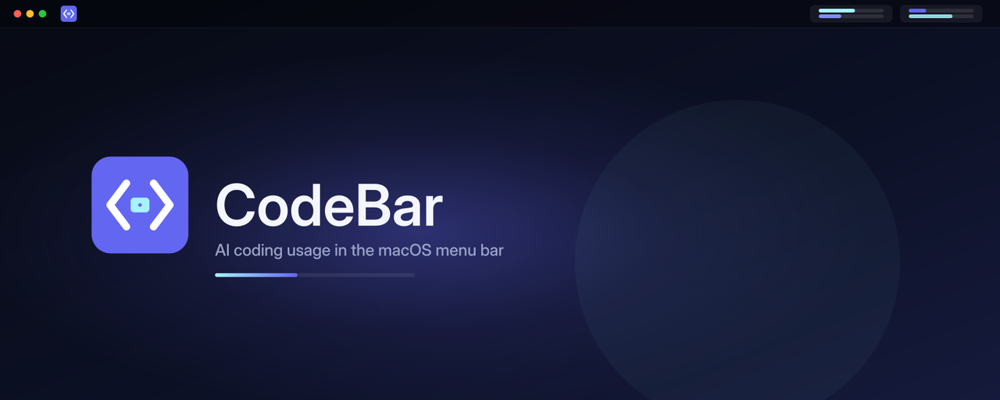
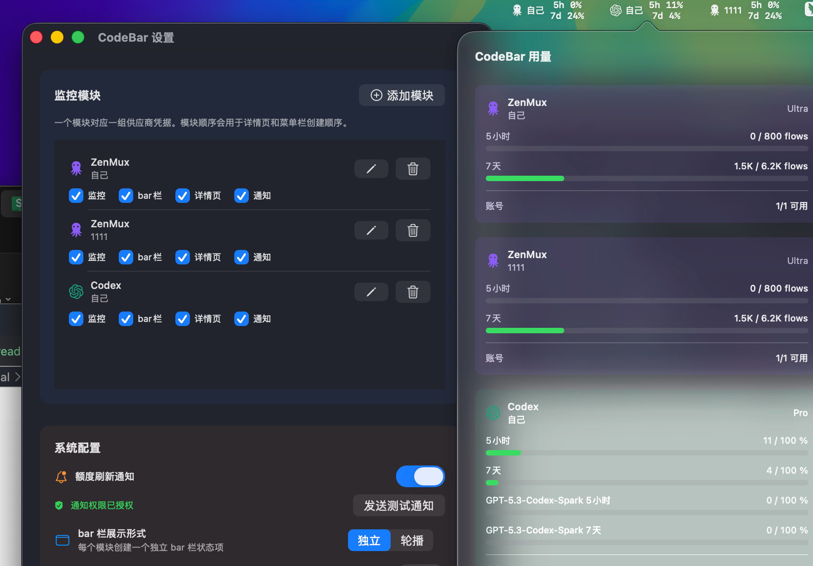
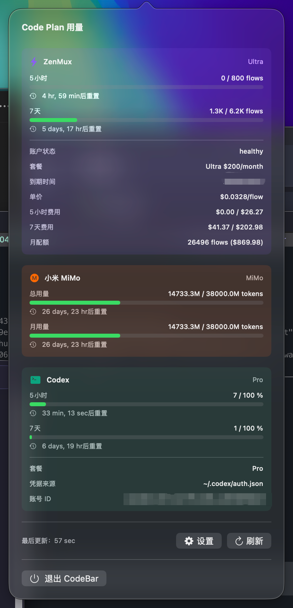
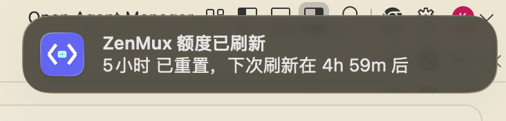

<div align="center">



# CodeBar

**macOS メニューバーで、AI コーディング枠の使用量を見守る。**

[English](README.md) · [简体中文](README.zh-CN.md) · [日本語](README.ja.md)

[](#動作環境)
[](#開発)
[](https://github.com/wayyoungboy/code_bar/releases/latest)
[](LICENSE)

AI コーディングプランの使用量をリアルタイムで見守る、macOS メニューバーアプリです。BaiLian、ZenMux、MiMo、Codex、Gemini、Grok、Antigravity の使用量とリセット時刻、それに OpenAI API の費用をメニューバーにまとめます。複数アカウントやチーム枠を同時に扱う人向けです。

</div>



> **Mac が必要です。** このプロジェクトは Xcode プロジェクト（`CodeBar.xcodeproj`、scheme は `CodeBar`）です。`Package.swift` はないため、Swift Package Manager ではインストールできません。Linux や Windows ではビルドも実行もできません。このリポジトリの GitHub Actions は `macos-15` 上で `xcodebuild` とスクリプトテストだけを実行し、**GUI は起動しません**。

更新前の中国語 README 全文は [docs/archive/README.before-branding.md](docs/archive/README.before-branding.md) に残してあります。

## ハイライト

| 機能 | 内容 |
|---|---|
| 複数プラットフォームの監視 | Alibaba Cloud BaiLian、ZenMux、Xiaomi MiMo、Codex、Gemini、Grok、Antigravity、OpenAI API |
| 複数アカウントのモジュール | ZenMux はアカウントごとにモジュールを追加し、それぞれ独立して表示できます |
| メニューバーの表示 | モジュールごとの独立したステータス項目、または 1 つの回転表示 |
| ノッチ Island | ノッチまわりの Island 表示に切り替え可能（設定の表示モードを参照） |
| 枠のリマインダー | 5 時間、7 日、週、月などの周期を、モジュールごとに通知できます |
| ローカル保存 | CodeBar 自身の設定は `~/.code_bar/` に書き込みます |
| 追加トークン不要の OAuth | 本機の Codex CLI / Gemini CLI の OAuth 資格情報を自動で読みます |

## プレビュー

| 複数モジュール | Codex の使用量 | 枠の更新通知 |
|---|---|---|
|  |  |  |

## 対応プラットフォーム

- **Alibaba Cloud BaiLian**：Coding Plan の使用量（請求月、5 時間、週）
- **ZenMux**：Flow の使用量（5 時間、7 日）。アカウントごとに独立した監視モジュールを追加できます
- **Xiaomi MiMo**：トークン使用量（月間と累計）
- **Codex**：本機の Codex CLI にある ChatGPT OAuth 資格情報を読み、公式の 5 時間 / 7 日サブスクリプション枠を問い合わせます
- **Gemini**：本機の Gemini CLI にある Google OAuth 資格情報を読み、公式の Code Assist クォータを問い合わせます
- **Grok**：本機の OAuth を再利用し、週次サブスクリプション枠を直接問い合わせて、トークンを自動更新します
- **OpenAI API**：組織の Admin API Key で、今日と今月の API 費用、今月のトークン数とリクエスト数を表示します。Codex サブスクリプションとは独立しています
- **Antigravity / AGY**：デスクトップ版または `agy` CLI に対応し、Gemini、Claude/GPT などのモデルプール枠を表示します

ほかのプラットフォームを追加したい場合は、プルリクエストを歓迎します。

## 機能

- 「モジュールを追加」から、ベンダーのアカウントや資格情報を 1 つずつ追加できます
- 各モジュールに別名を付けて、個人・チーム・プロジェクトのアカウントを区別できます
- 監視するか、メニューバーに出すか、詳細ページに出すかを、モジュールごとに選べます
- 設定でモジュールをドラッグして並べ替えられます。詳細ページとメニューバーもその順に従います
- メニューバーは「独立」と「回転」の 2 モードがあります
- ポップオーバーはモジュールごとに使用量、プラン、リセット時刻、その他の情報を表示します
- 各モジュールのクォータ周期は、表示するかどうか、リセットまでの残り時間を出すかどうかを個別に選べます
- ZenMux は Management API Key を複数登録でき、アカウントごとに独立したモジュールになります
- ZenMux はアカウントの使用量と、プラン、費用、単価、期限などの購読情報を表示します
- ZenMux の 5 時間 / 7 日枠が更新されると通知できます
- Codex は本機の Codex CLI OAuth を読むため、CodeBar にトークンを貼る必要はありません
- Codex は任意で、モジュールのプロキシ経由で `chatgpt.com/backend-api/wham/usage` をリクエストできます
- Gemini は本機の Gemini CLI OAuth を読むため、CodeBar にトークンを貼る必要はありません
- Gemini は任意で、モジュールのプロキシ経由で Google Code Assist のクォータ API を呼べます
- Grok は週次サブスクリプション枠を HTTP で問い合わせ、OAuth を自動更新します。完全な CLI は起動しません
- Antigravity は本機のデスクトップ版を自動検出するか、`agy` CLI のパスを指定して枠を問い合わせます
- Codex のネイティブ接続が失敗すると、互換チャネルへ自動的に切り替えます。証明書検証は維持し、モジュールまたはシステムのプロキシも引き継ぎます
- 60 秒ごとに自動更新し、±5 秒のランダムな jitter を入れて、リクエストが同時刻に重ならないようにします

## 動作環境

| 項目 | 値（プロジェクトファイルに基づく） |
|---|---|
| 実行 / デプロイ対象 | **macOS 13.0+**（`MACOSX_DEPLOYMENT_TARGET`、`LSMinimumSystemVersion`） |
| 言語 | **Swift 5.0**（`SWIFT_VERSION = 5.0`） |
| ローカル開発 | **Xcode 15.0+**（`CreatedOnToolsVersion = 15.0`）。Command Line Tools だけでは不十分で、完全な Xcode.app が必要です |
| プロジェクト形態 | `CodeBar.xcodeproj` / scheme **CodeBar** / 製品 **CodeBar.app** |
| 現在のリリース | **2.2.10**（`CodeBar/Info.plist` の `CFBundleShortVersionString` と `MARKETING_VERSION`） |
| 署名 | プロジェクトは Automatic signing です。ソースからビルドするときは署名をオフにしてください（CI および `build.sh` と同じ） |
| 起動形態 | `LSUIElement = true`：**Dock アイコンはありません**。アイコンはメニューバーにだけ出ます |

Linux、GitHub の `ubuntu-*` runner、Windows ではこのアプリをコンパイルできません。CI は `macos-15` と Xcode 16.x を使います。

## インストール

### リリースから入手する（Mac が必要）

1. [Releases](https://github.com/wayyoungboy/code_bar/releases) から最新の `CodeBar.dmg` をダウンロードします（現在の最新タグは [v2.2.10](https://github.com/wayyoungboy/code_bar/releases/tag/v2.2.10) です）。
2. DMG を開き、CodeBar を Applications にドラッグします。
3. 初回起動時、macOS が「開発元を検証できないため開けません」や「破損している」と表示することがあります。DMG は Apple の公証を受けていません。次のいずれかを行ってください。
   - **システム設定 → プライバシーとセキュリティ** を開き、一番下までスクロールして **このまま開く** を選ぶ
   - またはターミナルで次を実行する：
   ```bash
   xattr -cr /Applications/CodeBar.app
   ```
4. 起動後は **メニューバー** を見てください。Dock には出ません。

### ソースからビルドする（Mac + 完全な Xcode）

HTTPS でクローンします（GitHub の SSH 鍵は不要です）：

```bash
git clone https://github.com/wayyoungboy/code_bar.git
cd code_bar
```

**推奨：Xcode の GUI**

```bash
open CodeBar.xcodeproj
```

Xcode で scheme `CodeBar`、destination に **My Mac** を選び、Run（⌘R）します。初回に署名 / 開発者証明書の案内が出たら、ローカルのチームを選ぶか、次の署名なしコマンドラインビルドを使ってください。

**コマンドラインでの Debug ビルドと起動：**

```bash
xcodebuild -project CodeBar.xcodeproj \
  -scheme CodeBar \
  -configuration Debug \
  -destination 'generic/platform=macOS' \
  -derivedDataPath build \
  CODE_SIGN_IDENTITY="" \
  CODE_SIGNING_REQUIRED=NO \
  CODE_SIGNING_ALLOWED=NO \
  ENABLE_USER_SCRIPT_SANDBOXING=NO \
  COMPILER_INDEX_STORE_ENABLE=NO \
  build

open build/Build/Products/Debug/CodeBar.app
```

Debug ビルドでは `CodeBarTests/run_module_behavior_tests.sh` も走ります。これは Xcode の Run Script ビルドフェーズであり、**XCTest ターゲットではない** ので、`xcodebuild test` は使わないでください。スクリプトは `CONFIGURATION=Debug` のときだけ実行されます。

成果物は `build/Build/Products/Debug/CodeBar.app` です。必ず `-derivedDataPath` を付けてください。付けないと `.app` が `~/Library/Developer/Xcode/DerivedData/` に埋もれます。

署名なしの Release ビルドもできます：

```bash
./build.sh
```

`build.sh` は **Mac の対話型ターミナルで実行する必要があります**。ビルドフォルダを開くか、DMG を作るかを `read` で尋ねるため、CI やパイプの中では入力待ちで止まります。スクリプト内でもコード署名はオフです。成果物は `build/Build/Products/Release/CodeBar.app` です。CI のリリースはこのスクリプトを使いません。`v*` タグを push すると `.github/workflows/release.yml` が `macos-15` で `xcodebuild`、アドホック `codesign`、`CodeBar.dmg` の作成、GitHub Release へのアップロードを行います。

## 使い方

### 最初の設定

1. 起動したら、メニューバーの CodeBar アイコンをクリックします（Dock に無いのは正常です）。
2. 設定（歯車アイコン）を開きます。
3. **モジュールを追加** をクリックし、ベンダーを選んで、そのモジュールに必要な資格情報を入力します。
4. 保存後、モジュール一覧で **監視**、**メニューバー**、**詳細ページ** を切り替えられます。
5. モジュール一覧をドラッグして表示順を変えます。
6. モジュールの編集画面で、表示するクォータ周期とリセット時刻を選びます。

### モジュールのプロキシ

各ベンダーモジュールの編集ウィンドウには、任意の **プロキシ** 欄があります。モジュールごとに設定できます。例：

```text
http://127.0.0.1:7890
socks5://127.0.0.1:1080
```

- BaiLian、ZenMux（アカウントごと）、MiMo、Codex、Gemini の使用量リクエストは、そのモジュールのプロキシを使います。Gemini の OAuth 更新も同じプロキシを使います。
- Grok のサブスクリプション照会と OAuth 更新は、どちらも現在のモジュールプロキシを使います。
- AGY にプロキシを設定すると、`agy` CLI 経由で問い合わせます。CLI はあらかじめインストールしてログインしておく必要があります。ローカルのデスクトップ版との Language Server 通信は常に直接接続です。欄を空にすると、引き続きデスクトップ版の検出を優先します。その場合の外部プロキシは Antigravity 側の設定に従います。
- プロキシを空にすると、従来のシステムネットワークまたは CLI の環境を使います。1 つのモジュールを変えても、ほかのモジュールには影響しません。
- URL にはスキーム、ホスト、ポートが必要です。プロキシ URL のユーザー情報（`user:password@`）はまだ使えません。不正なアドレスは拒否され、保存は無効のままです。

### Alibaba Cloud BaiLian

設定で **モジュールを追加** を押し、**Alibaba Cloud BaiLian** を選んで、次を入力します。

- **Cookie**：ブラウザからコピーした Cookie 文字列一式
- **Sec Token**：リクエストからコピーした `sec_token` の値
- **リージョン**：`cn-beijing`、`cn-shanghai`、`cn-shenzhen`、または `cn-hangzhou`

入手手順：

1. https://bailian.console.aliyun.com/ にログインする
2. 開発者ツールを開き、Network を選ぶ
3. Coding Plan のページを開く
4. `api.json` リクエストを見つける
5. リクエストヘッダーから Cookie と `sec_token` をコピーする

### ZenMux

設定で **モジュールを追加** を押し、**ZenMux** を選びます。ZenMux アカウントはそれぞれ独立したモジュールです。入力内容：

- **アカウント別名**：プロジェクト、チーム、個人アカウントを区別するため
- **Management API Key**：ZenMux の管理画面からコピーした Management API Key

使えるのは Management API Key だけです。通常の API キーは受け付けません。

各アカウントモジュールは、5 時間 / 7 日のクォータと、それぞれのリセット時刻を個別に表示または非表示にできます。詳細ページでは、ZenMux アカウントはベンダー単位にまとめず、モジュールとして独立して表示されます。

ZenMux の 5 時間または 7 日枠が更新されると、CodeBar は macOS の通知を送れます。同じ周期で二重には通知しません。設定で通知のオンオフと、テスト通知の送信ができます。

### Xiaomi MiMo

設定で **モジュールを追加** を押し、**Xiaomi MiMo** を選んで、次を入力します。

- **Service Token**：ブラウザ Cookie の `api-platform_serviceToken`
- **User ID**：ブラウザ Cookie の `userId`

入手手順：

1. https://platform.xiaomimimo.com/ にログインする
2. 開発者ツールを開き、Application を選ぶ
3. Cookies から `platform.xiaomimimo.com` を選ぶ
4. `api-platform_serviceToken` と `userId` をコピーする

### Codex

設定で **モジュールを追加** を押し、**Codex** を選びます。CodeBar にトークンを設定する必要はありません。CodeBar は本機の Codex CLI の ChatGPT OAuth ファイル `~/.codex/auth.json` を読みます。

条件：

- Codex CLI が ChatGPT にログインしていること
- `auth_mode` が `chatgpt` であること
- OAuth 資格情報に `tokens.access_token` があること

CodeBar が呼ぶ公式エンドポイント：

```text
GET https://chatgpt.com/backend-api/wham/usage
```

リクエストヘッダーは Codex CLI / cc-switch に合わせています。

```text
Authorization: Bearer <access_token>
User-Agent: codex-cli
Accept: application/json
ChatGPT-Account-Id: <account_id>   # ある場合
```

表示できるもの：

- `plan_type`（例：`Pro`）
- 主たる `rate_limit` の 5 時間 / 7 日ウィンドウ
- `additional_rate_limits`
- `credits`
- `spend_control`
- `rate_limit_reset_credits.available_count`

`chatgpt.com` への直接接続が不安定なときは、Codex モジュールにプロキシを設定できます。

```text
http://127.0.0.1:7890
socks5://127.0.0.1:7890
```

モジュールプロキシが空のときは、macOS のシステムネットワーク設定に従い、固定プロキシは足しません。システム側にもプロキシが無ければ、直接リクエストします。

### Gemini

設定で **モジュールを追加** を押し、**Gemini** を選びます。CodeBar にトークンを設定する必要はありません。CodeBar は本機の Gemini CLI の Google OAuth ファイル `~/.gemini/oauth_creds.json` を読みます。

条件：

- Gemini CLI が Google OAuth でログインしていること
- OAuth 資格情報に `access_token` があること
- `access_token` の期限が切れている場合は、更新できるように `refresh_token` が必要です

公式エンドポイント（cc-switch と同様）：

```text
POST https://cloudcode-pa.googleapis.com/v1internal:loadCodeAssist
POST https://cloudcode-pa.googleapis.com/v1internal:retrieveUserQuota
```

表示できるもの：

- Gemini Pro
- Gemini Flash
- Gemini Flash Lite

Google Code Assist API への直接接続が不安定なときは、Gemini モジュールにプロキシを設定できます。

```text
http://127.0.0.1:7890
socks5://127.0.0.1:7890
```

### Grok

設定で **モジュールを追加** を押し、**Grok** を選びます。既定のディレクトリは `~/.grok/` です。別の Grok ディレクトリを指定することもできます。

- 先に、この Mac の Grok でサブスクリプションアカウントにログインしてください。CodeBar は `auth.json` を読み、HTTP でサブスクリプション使用量を問い合わせます。完全な CLI は起動せず、`/usage` を手で実行する必要もありません。
- OAuth の期限が近づいたとき、またはサブスクリプション API が 401 を返したときは、自動でトークンを更新します。更新後のトークンは、資格情報ロックとアトミックな書き込みで、同じ `auth.json` に mode `0600` で保存されます。CodeBar 自身の設定にはコピーしません。
- UI には週次使用量のパーセント、リセット時刻、最終同期時刻を出します。以前のバックグラウンド CLI スイッチは無視されます。アップグレード後は、照会はすべて HTTP になります。
- 週次枠のリセット後、API が 0 のパーセント欄を省略した場合、週次ペイロードが揃って一貫しているときだけ 0% を表示します。不完全または想定外の応答は、これまでどおりエラーになります。
- サブスクリプション API は Grok のログイン状態を使います。通常の API キー / Management キーによる API 課金は、週次サブスクリプション枠とは別です。
- このサブスクリプション API は、公式 CLI が使う内部呼び出しに由来します。API が変わると CodeBar の更新が必要になることがあります。認可が取り消されたときは、先に Grok へ再ログインしてください。

Grok の使用量表示精度とレート制限の扱いを改善する草稿が [PR #9](https://github.com/wayyoungboy/code_bar/pull/9) にあります。**未マージ**であり、**v2.2.10 リリースには含まれません**。

### OpenAI API の課金

設定で **モジュールを追加** を押し、**OpenAI API** を選びます。組織の管理者アカウントで [Admin keys](https://platform.openai.com/settings/organization/admin-keys) から管理キーを作り、**Admin API Key** に貼り付けてください。通常のプロジェクト API キーや Codex OAuth では動きません。

- メニューバーと詳細表示には、今日と今月の費用を USD で出します。割合で表せる課金枠が無いときは、実際の金額を出します。パーセントや口座残高は作りません。
- 日付の境界は UTC です。費用は公式の [Costs API](https://developers.openai.com/api/reference/resources/admin/subresources/organization/subresources/usage/methods/costs) から取得し、現在の組織の全プロジェクトを対象にします。反映が遅れることがあります。空の費用記録は、その旨を明示します。
- モジュールは Admin Key で公式 API だけを呼びます。ギフト / 前払いクレジットの残高と期限は Costs API からは返りません。CodeBar は現在、管理 API 経由でそれらを取得しておらず、$0.00 の費用を残高ゼロとはみなしません。
- トークン数とリクエスト数は [Completions Usage API](https://developers.openai.com/api/reference/resources/admin/subresources/organization/subresources/usage/methods/completions) から取得します。入力トークンにはキャッシュ入力がすでに含まれており、二重加算しません。費用はすべての API 製品を含むため、トークン内訳の対象範囲とは一致しません。
- モジュールごとにプロキシ、日次 / 月次費用の表示、設定の編集ができます。トークン内訳が一時的に取れないときは、すでに取得できた費用データは残し、理由を表示します。
- Admin Key は、ほかの手動資格情報と同じく、この Mac の `~/.code_bar/` 配下にある権限を絞った設定ファイルに保存されます。プロジェクトや実行ログには書き込みません。公式の読み取り専用 OpenAI 課金 API にだけ使います。

### Antigravity / AGY

設定で **モジュールを追加** を押し、**Antigravity** を選びます。

- デスクトップ版：Antigravity を起動してログインします。CodeBar は本機の Language Server のポートと CSRF トークンを自動で見つけます。
- CLI：公式の `agy` をインストールしてログインします。CodeBar は `agy -p /usage --output-format json` に対応します。**agy CLI パス** を入れると、そのバイナリを優先します。
- 既定では Gemini の 5 時間枠と週次枠を表示します。詳細ページには、API が実際に返すすべてのモデルプール枠（Claude/GPT や Argon を含む）を出します。
- ローカルエンドポイントと CSRF トークンは任意の上級設定です。受け付けるのは本機の HTTP/HTTPS アドレスだけです。

## プロジェクト構成

いま実行できるアプリは、Swift のメニューバーアプリです。リポジトリには古い Go/Wails の残骸も残っています。**ビルドには使わないでください。**

```text
code_bar/
├── CodeBar.xcodeproj/             # サポートする唯一のビルド入口（SPM ではない）
│   ├── project.pbxproj
│   └── xcshareddata/xcschemes/CodeBar.xcscheme
├── CodeBar/
│   ├── CodeBarApp.swift           # アプリ入口、メニューバー、ポップオーバー
│   ├── MenuBarView.swift          # ポップオーバー UI
│   ├── IslandMode.swift           # ノッチ Island 表示
│   ├── IslandPanelController.swift
│   ├── SettingsWindow.swift       # 設定ウィンドウ
│   ├── UsageTracker.swift         # 使用量トラッカー
│   ├── Constants.swift
│   ├── CodeBarFileStore.swift     # ~/.code_bar のファイル保存
│   ├── StatusBarIconRenderer.swift
│   ├── StatusBarUsagePresentation.swift
│   ├── UpdateChecker.swift
│   ├── Info.plist                 # バージョン 2.2.10、LSUIElement
│   └── Providers/
│       ├── PlatformProvider.swift
│       ├── BailianProvider.swift
│       ├── ZenMuxProvider.swift
│       ├── MimoProvider.swift
│       ├── CodexProvider.swift
│       ├── GeminiProvider.swift
│       ├── GrokProvider.swift
│       ├── GrokSubscriptionClient.swift
│       ├── OpenAIAPIProvider.swift
│       └── AntigravityProvider.swift
├── CodeBarTests/                  # Debug 時のスクリプトテスト。XCTest ターゲットではない
│   ├── ModuleBehaviorTests.swift
│   ├── TestNotifications.swift
│   ├── UsageProviderTests.swift
│   └── run_module_behavior_tests.sh
├── .github/workflows/
│   ├── ci.yml                     # macos-15 での xcodebuild Debug と振る舞いテスト
│   ├── release.yml                # v* タグ後の DMG
│   └── pages.yml                  # ドキュメントサイトのビルド。デプロイは main または手動実行のみ
├── build.sh                       # Mac 上の対話型 Release パッケージ
├── create_dmg.sh
├── logo/                          # プロジェクトのマーク、ワードマーク、ヘッダー
├── site/                          # GitHub Pages サイトのソース
├── frontend/                      # 残り物：旧 Go/Wails フロントエンド。現行アプリは使わない
├── internal/tray/                 # 残り物：旧 Go tray。現行アプリは使わない
└── docs/                          # 更新前 README の全文は docs/archive/ に保存
```

## 開発

プロバイダー追加の手順は [docs/developer-guide.md](docs/developer-guide.md) を見てください。`Package.swift` はありません。`swift build` / `swift test` は実行しないでください。

### ビルド確認（Mac + Xcode）

```bash
xcodebuild -project CodeBar.xcodeproj \
  -scheme CodeBar \
  -configuration Debug \
  -destination 'generic/platform=macOS' \
  -derivedDataPath build \
  CODE_SIGN_IDENTITY="" \
  CODE_SIGNING_REQUIRED=NO \
  CODE_SIGNING_ALLOWED=NO \
  ENABLE_USER_SCRIPT_SANDBOXING=NO \
  COMPILER_INDEX_STORE_ENABLE=NO \
  build

xcodebuild -project CodeBar.xcodeproj \
  -scheme CodeBar \
  -configuration Release \
  -destination 'generic/platform=macOS' \
  -derivedDataPath build \
  CODE_SIGN_IDENTITY="" \
  CODE_SIGNING_REQUIRED=NO \
  CODE_SIGNING_ALLOWED=NO \
  ENABLE_USER_SCRIPT_SANDBOXING=NO \
  COMPILER_INDEX_STORE_ENABLE=NO \
  build
```

振る舞いテストだけを走らせる場合（同じく Mac 上の `swiftc` / macOS SDK が必要です）：

```bash
CONFIGURATION=Debug CodeBarTests/run_module_behavior_tests.sh
```

CI も同じです。`.github/workflows/ci.yml` は `macos-15` で Xcode 16.x を選び、署名をオフにして Debug を `xcodebuild` し、同じスクリプトを実行します。**CI が通っても、実機のメニューバーを操作したことにはなりません。**

### 未リリースの作業

[草稿 PR #9](https://github.com/wayyoungboy/code_bar/pull/9) は、Grok サブスクリプション使用量の表示精度とレート制限の扱いを改善します。そのブランチの macOS CI は通っていますが、**未マージ**であり、**v2.2.10 には含まれません**。

### リリース

1. `CodeBar/Info.plist` の `CFBundleShortVersionString` と、`project.pbxproj` の `MARKETING_VERSION` を同時に更新する
2. バージョン変更をコミットする
3. タグを作成して push する：

```bash
git tag -a v2.2.10 -m "CodeBar v2.2.10"
git push origin v2.2.10
```

その後、GitHub Actions（`macos-15`）がビルド、アドホック署名、DMG 作成、GitHub Release へのアップロードを行います。リリース用 runner も Mac である必要があります。ローカルの `./build.sh` は、自分用のインストーラーを作るときだけ使ってください。

## セキュリティ

- CodeBar 自身の設定は `~/.code_bar/` に保存します
- Codex の OAuth 資格情報は、既存の Codex CLI の場所から読むだけです。トークンを CodeBar の設定へコピーしません
- Gemini の OAuth 資格情報は、既存の Gemini CLI の場所から読むだけです。トークンを CodeBar の設定へコピーしません
- Grok が触るのは、本機の OAuth ファイル、資格情報ロック、同じディレクトリのアトミック更新用一時ファイルだけです。サブスクリプション照会と更新は HTTPS です。CLI は起動せず、作業ツリーも走査しません
- Antigravity で自動検出した CSRF トークンは、本機のサービスとの通信にだけ使います
- 互換経路の Codex リクエストは、認証ヘッダーを標準入力で渡し、コマンドライン引数には載せません
- ログイン資格情報は、対応するベンダーの認証または使用量エンドポイントにだけ送られます。リクエストログには書かず、第三者とも共有しません
- 実行時のリクエスト、使用量、資格情報に関するログは、既定では書きません

## 商標とロゴ

アプリ内の各ベンダーロゴは、そのサービスを識別するためだけに使っています。商標とロゴの権利は、それぞれの権利者に属します。CodeBar は Alibaba Cloud、ZenMux、Xiaomi、OpenAI、Google、xAI と提携しておらず、後援や公式な許諾も受けていません。

- ZenMux ロゴの出典：[zenmux.ai](https://zenmux.ai/)
- Xiaomi / Mi ロゴの出典：[mi.com](https://www.mi.com/)
- OpenAI / ChatGPT ロゴの出典：[chatgpt.com/codex](https://chatgpt.com/zh-Hans-CN/codex/)
- Gemini ロゴの出典：[gstatic.com](https://www.gstatic.com/lamda/images/gemini_sparkle_aurora_33f86dc0c0257da337c63.svg)

権利者の方が表示の変更や削除を希望される場合は、Issue でご連絡ください。

## ライセンス

MIT License — [LICENSE](LICENSE) を参照してください。

## 貢献

Issue とプルリクエストを歓迎します。上のコマンドで、**Mac + Xcode 15+** にて Debug の `xcodebuild` を確認してください。Linux 向けの CI は追加しないでください。UI を変えたあとは、実機のメニューバーを操作して確認してください。Actions のビルドが緑でも、GUI が使えることにはなりません。

## 謝辞

- [Alibaba Cloud BaiLian](https://bailian.console.aliyun.com/) — Coding Plan の使用量
- [ZenMux](https://zenmux.ai) — AI コーディングプラットフォーム
- [Xiaomi MiMo](https://platform.xiaomimimo.com/) — AI プログラミングプラットフォーム
- [OpenAI Codex](https://openai.com/codex/) — Codex CLI / ChatGPT OAuth の使用量
- [OpenAI API](https://platform.openai.com/) — 組織管理の課金 API
- [Gemini CLI](https://github.com/google-gemini/gemini-cli) — Google OAuth / Code Assist クォータ
- [Grok](https://grok.com/) — 本機 OAuth によるサブスクリプション使用量
- [Antigravity](https://antigravity.google/) — デスクトップ Language Server と `agy` CLI の枠
