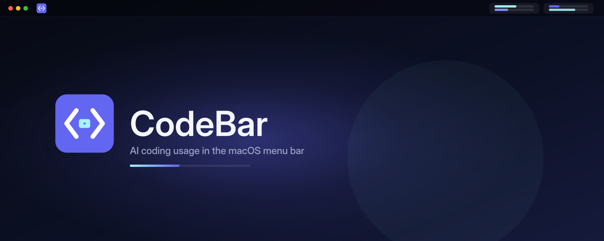
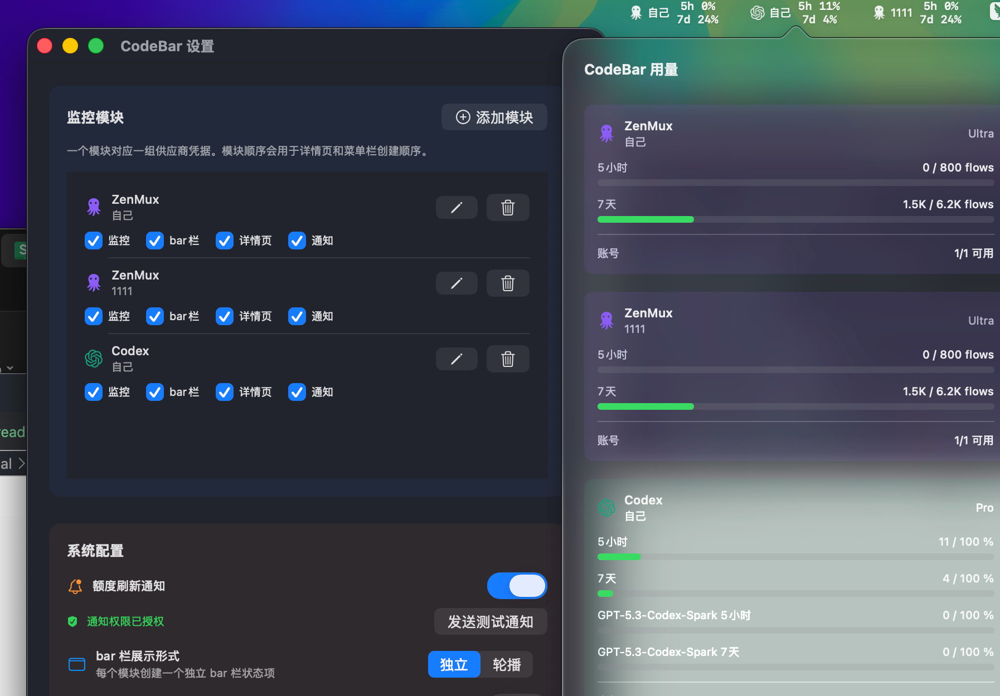
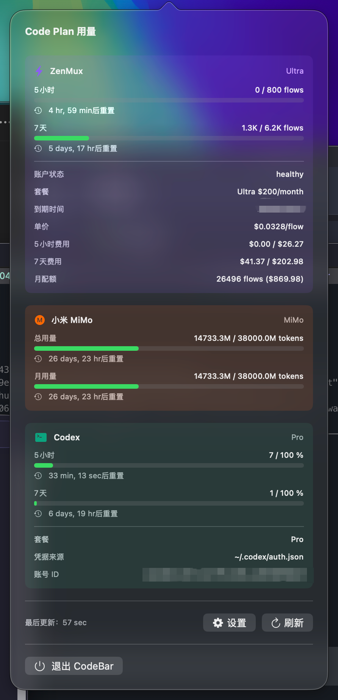
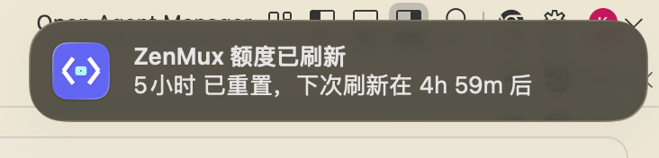

<div align="center">



# CodeBar

**AI coding usage, right in the macOS menu bar.**

[English](README.md) · [简体中文](README.zh-CN.md) · [日本語](README.ja.md)

[](#system-requirements)
[](#development)
[](https://github.com/wayyoungboy/code_bar/releases/latest)
[](LICENSE)

A macOS menu bar app that watches AI coding plan usage in real time. It pulls quotas and reset times from BaiLian, ZenMux, MiMo, Codex, Gemini, Grok, and Antigravity, plus OpenAI API costs, into the menu bar — useful if you juggle more than one account or team allowance.

</div>



> **This is a Mac app.** The project is an Xcode project (`CodeBar.xcodeproj`, scheme `CodeBar`). There is no `Package.swift`, so you cannot install it with Swift Package Manager, and you cannot build or run it on Linux or Windows. GitHub Actions in this repository only run `xcodebuild` and script tests on `macos-15`. **They do not launch the GUI.**

## Highlights

| Capability | What it does |
|---|---|
| Multi-platform monitoring | Alibaba Cloud BaiLian, ZenMux, Xiaomi MiMo, Codex, Gemini, Grok, Antigravity, and OpenAI API |
| Multi-account modules | ZenMux can be added as one module per account, each shown on its own |
| Menu bar layout | Independent status items, or a single rotating status item |
| Notch Island | Optional Island layout around the notch (see display mode in Settings) |
| Quota reminders | Optional reminders per module for 5-hour, 7-day, weekly, or monthly windows |
| Local storage | CodeBar writes its own settings under `~/.code_bar/` |
| OAuth without extra tokens | Reads local Codex CLI / Gemini CLI OAuth credentials automatically |

## Preview

| Several modules | Codex usage | Quota refresh notification |
|---|---|---|
|  |  |  |

## Supported platforms

- **Alibaba Cloud BaiLian**: Coding Plan usage (billing month, 5-hour, and weekly windows)
- **ZenMux**: Flow usage (5-hour and 7-day), with a separate module per account
- **Xiaomi MiMo**: token usage (monthly and total)
- **Codex**: reads ChatGPT OAuth credentials from the local Codex CLI and queries the official 5-hour / 7-day subscription quotas
- **Gemini**: reads Google OAuth credentials from the local Gemini CLI and queries official Code Assist quotas
- **Grok**: reuses local OAuth, queries the weekly subscription quota directly, and refreshes tokens automatically
- **OpenAI API**: uses an organization Admin API Key to show today's and this month's API cost, plus this month's tokens and request counts — independent of a Codex subscription
- **Antigravity / AGY**: desktop app or the `agy` CLI, showing pool quotas for Gemini, Claude/GPT, and others

Want another platform? Pull requests are welcome.

## Features

- Add vendor accounts or credentials one module at a time with “Add Module”
- Give each module an alias so personal, team, or project accounts stay distinct
- Choose per module whether it is monitored, shown in the menu bar, and shown on the detail page
- Drag modules in Settings to change order; the detail page and menu bar follow that order
- Menu bar layout can be “independent” or “rotating”
- The popover shows usage, plan, reset time, and extra fields per module
- Each quota window on a module can be shown or hidden, including remaining time until reset
- ZenMux accepts multiple Management API Keys; each account is its own module
- ZenMux shows account usage and full subscription details (plan, cost, unit price, expiry, and similar fields)
- ZenMux quota-refresh notifications for the 5-hour / 7-day windows
- Codex reads local Codex CLI OAuth; you do not paste a token into CodeBar
- Codex can optionally send `chatgpt.com/backend-api/wham/usage` through a module proxy
- Gemini reads local Gemini CLI OAuth; you do not paste a token into CodeBar
- Gemini can optionally send Code Assist quota requests through a module proxy
- Grok queries the weekly subscription quota over HTTP and refreshes OAuth itself; it does not launch the full CLI
- Antigravity discovers a local desktop install automatically, or you can point it at an `agy` CLI path
- If a native Codex request fails, CodeBar falls back to a compatibility channel, still verifying certificates and still using the module or system proxy
- Auto-refresh every 60 seconds, with a random jitter of ±5 seconds so requests do not all line up

## System requirements

| Item | Value (from the project files) |
|---|---|
| Run / deploy target | **macOS 13.0+** (`MACOSX_DEPLOYMENT_TARGET`, `LSMinimumSystemVersion`) |
| Language | **Swift 5.0** (`SWIFT_VERSION = 5.0`) |
| Local development | **Xcode 15.0+** (`CreatedOnToolsVersion = 15.0`). You need the full Xcode.app, not just Command Line Tools |
| Project shape | `CodeBar.xcodeproj` / scheme **CodeBar** / product **CodeBar.app** |
| Current release | **2.2.10** (`CFBundleShortVersionString` in `CodeBar/Info.plist`, and `MARKETING_VERSION`) |
| Signing | The project uses Automatic signing; for source builds, turn signing off (same as CI and `build.sh`) |
| Launch style | `LSUIElement = true`: **no Dock icon**. The icon lives in the menu bar only |

Linux, GitHub `ubuntu-*` runners, and Windows cannot compile this app. CI uses `macos-15` with Xcode 16.x.

## Install

### From a Release (Mac required)

1. Go to [Releases](https://github.com/wayyoungboy/code_bar/releases) and download the latest `CodeBar.dmg` (the current latest tag is [v2.2.10](https://github.com/wayyoungboy/code_bar/releases/tag/v2.2.10)).
2. Open the DMG and drag CodeBar into Applications.
3. The first launch may say the app “can't be opened because the developer cannot be verified” or that it is “damaged”. The DMG is not notarized by Apple. You can:
   - Open **System Settings → Privacy & Security**, scroll to the bottom, and choose **Open Anyway**
   - Or run this in Terminal:
   ```bash
   xattr -cr /Applications/CodeBar.app
   ```
4. After it starts, look in the **menu bar**. There is no Dock icon.

### Build from source (Mac + full Xcode)

Clone over HTTPS (no GitHub SSH key required):

```bash
git clone https://github.com/wayyoungboy/code_bar.git
cd code_bar
```

**Recommended: Xcode GUI**

```bash
open CodeBar.xcodeproj
```

In Xcode, choose scheme `CodeBar`, destination **My Mac**, then Run (⌘R). If a signing / developer-certificate prompt appears the first time, pick a local team or use the unsigned command-line build below.

**Command-line Debug build and launch:**

```bash
xcodebuild -project CodeBar.xcodeproj \
  -scheme CodeBar \
  -configuration Debug \
  -destination 'generic/platform=macOS' \
  -derivedDataPath build \
  CODE_SIGN_IDENTITY="" \
  CODE_SIGNING_REQUIRED=NO \
  CODE_SIGNING_ALLOWED=NO \
  ENABLE_USER_SCRIPT_SANDBOXING=NO \
  COMPILER_INDEX_STORE_ENABLE=NO \
  build

open build/Build/Products/Debug/CodeBar.app
```

A Debug build also runs `CodeBarTests/run_module_behavior_tests.sh`. That script is an Xcode Run Script build phase, **not** an XCTest target, so do not use `xcodebuild test`. The script runs only when `CONFIGURATION=Debug`.

The app lands at `build/Build/Products/Debug/CodeBar.app`. Always pass `-derivedDataPath`; otherwise the `.app` disappears into `~/Library/Developer/Xcode/DerivedData/`.

You can also make an unsigned Release build:

```bash
./build.sh
```

`build.sh` **must be run in an interactive Terminal on a Mac**: it `read`s whether to open the build folder and whether to create a DMG. In CI or a pipe, it will hang waiting for input. The script also disables code signing. The product is `build/Build/Products/Release/CodeBar.app`. CI releases do not use this script: pushing a `v*` tag runs `.github/workflows/release.yml` on `macos-15`, which runs `xcodebuild`, ad-hoc `codesign`, builds `CodeBar.dmg`, and uploads the GitHub Release.

## Usage

### First-time setup

1. After launch, click the CodeBar icon in the menu bar (no Dock icon is expected).
2. Open Settings (the gear icon).
3. Click **Add Module**, pick a vendor, and fill in the credentials that module needs.
4. After saving, use the module list to toggle **Monitor**, **Menu bar**, and **Detail page**.
5. Drag the module list to change display order.
6. Open a module's edit page and choose which quota windows and reset times to show.

### Module proxies

Every vendor module's edit window has an optional **Proxy** field. You can set it independently, for example:

```text
http://127.0.0.1:7890
socks5://127.0.0.1:1080
```

- BaiLian, ZenMux (per account), MiMo, Codex, and Gemini usage requests use that module's proxy. Gemini OAuth refresh uses the same proxy.
- Grok subscription queries and OAuth refresh both use the current module proxy.
- If you set a proxy on AGY, CodeBar queries through the `agy` CLI, which must already be installed and signed in. Language Server traffic to a local desktop install is always direct. When the field is empty, CodeBar still prefers a discovered desktop install; any outbound proxy is then whatever Antigravity itself uses.
- Leaving the proxy blank keeps the previous system network or CLI environment. Changing one module does not change the others.
- The URL must include a scheme, host, and port. Userinfo (`user:password@`) in the proxy URL is not supported yet. An invalid address is rejected and Save stays disabled.

### Alibaba Cloud BaiLian

In Settings, click **Add Module**, choose **Alibaba Cloud BaiLian**, and fill in:

- **Cookie**: the full Cookie string copied from the browser
- **Sec Token**: the `sec_token` value from the request
- **Region**: `cn-beijing`, `cn-shanghai`, `cn-shenzhen`, or `cn-hangzhou`

How to get them:

1. Sign in at https://bailian.console.aliyun.com/
2. Open developer tools and go to Network
3. Open the Coding Plan page
4. Find the `api.json` request
5. Copy Cookie and `sec_token` from the request headers

### ZenMux

In Settings, click **Add Module** and choose **ZenMux**. Each ZenMux account is its own module. Fill in:

- **Account alias**: to tell project, team, or personal accounts apart
- **Management API Key**: copied from the ZenMux admin page

Only a Management API Key works. A standard API key is not accepted.

Each account module can independently show or hide the 5-hour / 7-day quotas and their reset times. On the detail page, every ZenMux account stays a separate module; they are not rolled up by vendor.

When a ZenMux 5-hour or 7-day window refreshes, CodeBar can send a macOS notification. The same window is not notified twice. Settings can toggle the notification and send a test notification.

### Xiaomi MiMo

In Settings, click **Add Module**, choose **Xiaomi MiMo**, and fill in:

- **Service Token**: `api-platform_serviceToken` from the browser cookies
- **User ID**: `userId` from the browser cookies

How to get them:

1. Sign in at https://platform.xiaomimimo.com/
2. Open developer tools and go to Application
3. Under Cookies, select `platform.xiaomimimo.com`
4. Copy `api-platform_serviceToken` and `userId`

### Codex

In Settings, click **Add Module** and choose **Codex**. Codex does not need a token inside CodeBar. CodeBar reads the Codex CLI ChatGPT OAuth file at `~/.codex/auth.json`.

Requirements:

- Codex CLI is signed in to ChatGPT
- `auth_mode` is `chatgpt`
- The OAuth credentials include `tokens.access_token`

CodeBar calls this official endpoint:

```text
GET https://chatgpt.com/backend-api/wham/usage
```

Request headers follow Codex CLI / cc-switch:

```text
Authorization: Bearer <access_token>
User-Agent: codex-cli
Accept: application/json
ChatGPT-Account-Id: <account_id>   # when present
```

What can be shown:

- `plan_type`, for example `Pro`
- the primary `rate_limit` 5-hour / 7-day windows
- `additional_rate_limits`
- `credits`
- `spend_control`
- `rate_limit_reset_credits.available_count`

If a direct connection to `chatgpt.com` is unreliable, set a proxy on the Codex module:

```text
http://127.0.0.1:7890
socks5://127.0.0.1:7890
```

With no module proxy, CodeBar follows the macOS system network settings and does not inject a fixed proxy. If the system also has no proxy, the request goes out directly.

### Gemini

In Settings, click **Add Module** and choose **Gemini**. Gemini does not need a token inside CodeBar. CodeBar reads the Gemini CLI Google OAuth file at `~/.gemini/oauth_creds.json`.

Requirements:

- Gemini CLI is signed in with Google OAuth
- The OAuth credentials include `access_token`
- If `access_token` is expired, the file needs a `refresh_token` so CodeBar can refresh it

The official endpoints, aligned with cc-switch:

```text
POST https://cloudcode-pa.googleapis.com/v1internal:loadCodeAssist
POST https://cloudcode-pa.googleapis.com/v1internal:retrieveUserQuota
```

What can be shown:

- Gemini Pro
- Gemini Flash
- Gemini Flash Lite

If a direct connection to the Google Code Assist APIs is unreliable, set a proxy on the Gemini module:

```text
http://127.0.0.1:7890
socks5://127.0.0.1:7890
```

### Grok

In Settings, click **Add Module** and choose **Grok**. The default directory is `~/.grok/`; you can point it at another Grok directory.

- Sign in to the Grok subscription account on this Mac first. CodeBar reads `auth.json` and queries subscription usage over HTTP. It does not launch the full CLI, and you do not need to run `/usage` by hand.
- When OAuth is close to expiry, or the subscription endpoint returns 401, CodeBar refreshes the token. The rotated token is written back to the same `auth.json` through a credential lock and an atomic write, with mode `0600`. It is not copied into CodeBar's own config.
- The UI shows weekly usage percent, reset time, and last sync time. The older background-CLI toggle is ignored; after upgrading, every query goes over HTTP.
- After a weekly quota reset, if the API omits a percentage field that is zero, CodeBar shows 0% only when the weekly payload is complete and consistent. Incomplete or unexpected responses still error.
- The subscription endpoint uses the Grok login session. Ordinary API keys / Management keys for API billing are separate from the weekly subscription quota.
- This subscription endpoint comes from an internal call used by the official CLI. If that API changes, CodeBar may need an update. If authorization is revoked, sign in to Grok again first.

A draft change for more precise Grok usage display and rate-limit handling exists as [PR #9](https://github.com/wayyoungboy/code_bar/pull/9). It is **not merged** and is **not part of the v2.2.10 release**.

### OpenAI API billing

In Settings, click **Add Module**, choose **OpenAI API**, then use an organization admin account to create a key at [Admin keys](https://platform.openai.com/settings/organization/admin-keys) and paste it into **Admin API Key**. A regular project API key and Codex OAuth will not work.

- The menu bar and detail view show today's and this month's cost in USD. When there is no billed quota to express as a percentage, CodeBar shows the actual amount. It does not invent a percentage or an account balance.
- Day boundaries are UTC. Costs come from the official [Costs API](https://developers.openai.com/api/reference/resources/admin/subresources/organization/subresources/usage/methods/costs) and cover every project in the current organization. Ingestion can lag. Empty cost records are labeled as such.
- The module only calls official APIs with the Admin Key. Gifted / prepaid credit balances and expiry dates are not returned by the Costs API. CodeBar does not currently read those through an admin API, and it will not treat a $0.00 cost as a zero balance.
- Token and request counts come from the [Completions Usage API](https://developers.openai.com/api/reference/resources/admin/subresources/organization/subresources/usage/methods/completions). Cached input tokens are already included in input tokens and are not added twice. Cost includes all API products, so its scope is not identical to the token breakdown.
- Each module can have its own proxy, choose whether to show daily / monthly cost, and be edited later. If the token breakdown is temporarily unavailable, already-fetched cost data is kept and the reason is shown.
- The Admin Key is stored with other manual credentials in a permission-restricted file under `~/.code_bar/` on this Mac. It is not written into the project or into runtime logs, and it is used only for official read-only OpenAI billing APIs.

### Antigravity / AGY

In Settings, click **Add Module** and choose **Antigravity**.

- Desktop: start and sign in to Antigravity. CodeBar discovers the local Language Server port and CSRF token automatically.
- CLI: install and sign in to the official `agy`. CodeBar supports `agy -p /usage --output-format json`. If you fill in **agy CLI path**, that binary is preferred.
- The default view shows Gemini 5-hour and weekly quotas. The detail page shows every model-pool quota the API actually returns, including Claude/GPT and Argon.
- Local endpoint and CSRF token are optional advanced settings. Only local HTTP/HTTPS addresses are accepted.

## Project structure

The app you can run today is the Swift menu bar app. The repository still contains leftover Go/Wails files. **Do not use those to build.**

```text
code_bar/
├── CodeBar.xcodeproj/             # only supported build entry (not SPM)
│   ├── project.pbxproj
│   └── xcshareddata/xcschemes/CodeBar.xcscheme
├── CodeBar/
│   ├── CodeBarApp.swift           # app entry, menu bar, and popover
│   ├── MenuBarView.swift          # popover UI
│   ├── IslandMode.swift           # notch Island layout
│   ├── IslandPanelController.swift
│   ├── SettingsWindow.swift       # Settings window
│   ├── UsageTracker.swift         # usage tracker
│   ├── Constants.swift
│   ├── CodeBarFileStore.swift     # ~/.code_bar file storage
│   ├── StatusBarIconRenderer.swift
│   ├── StatusBarUsagePresentation.swift
│   ├── UpdateChecker.swift
│   ├── Info.plist                 # version 2.2.10, LSUIElement
│   └── Providers/
│       ├── PlatformProvider.swift
│       ├── BailianProvider.swift
│       ├── ZenMuxProvider.swift
│       ├── MimoProvider.swift
│       ├── CodexProvider.swift
│       ├── GeminiProvider.swift
│       ├── GrokProvider.swift
│       ├── GrokSubscriptionClient.swift
│       ├── OpenAIAPIProvider.swift
│       └── AntigravityProvider.swift
├── CodeBarTests/                  # Debug-time script tests, not an XCTest target
│   ├── ModuleBehaviorTests.swift
│   ├── TestNotifications.swift
│   ├── UsageProviderTests.swift
│   └── run_module_behavior_tests.sh
├── .github/workflows/
│   ├── ci.yml                     # macos-15 xcodebuild Debug + behavior tests
│   ├── release.yml                # DMG after a v* tag
│   └── pages.yml                  # docs site build; deploy only from main or a manual run
├── build.sh                       # interactive Release packaging on a Mac
├── create_dmg.sh
├── logo/                          # project mark, wordmark, and header
├── site/                          # source for the GitHub Pages site
├── frontend/                      # leftover Go/Wails frontend; the current app does not use it
├── internal/tray/                 # leftover Go tray; the current app does not use it
└── docs/                          # including docs/archive/ for the pre-update README
```

The previous Chinese README is kept in full at [docs/archive/README.before-branding.md](docs/archive/README.before-branding.md).

## Development

Steps for adding a provider are in [docs/developer-guide.md](docs/developer-guide.md). There is no `Package.swift`. Do not run `swift build` / `swift test`.

### Build checks (Mac + Xcode)

```bash
xcodebuild -project CodeBar.xcodeproj \
  -scheme CodeBar \
  -configuration Debug \
  -destination 'generic/platform=macOS' \
  -derivedDataPath build \
  CODE_SIGN_IDENTITY="" \
  CODE_SIGNING_REQUIRED=NO \
  CODE_SIGNING_ALLOWED=NO \
  ENABLE_USER_SCRIPT_SANDBOXING=NO \
  COMPILER_INDEX_STORE_ENABLE=NO \
  build

xcodebuild -project CodeBar.xcodeproj \
  -scheme CodeBar \
  -configuration Release \
  -destination 'generic/platform=macOS' \
  -derivedDataPath build \
  CODE_SIGN_IDENTITY="" \
  CODE_SIGNING_REQUIRED=NO \
  CODE_SIGNING_ALLOWED=NO \
  ENABLE_USER_SCRIPT_SANDBOXING=NO \
  COMPILER_INDEX_STORE_ENABLE=NO \
  build
```

Run the behavior tests on their own (also needs `swiftc` / the macOS SDK on a Mac):

```bash
CONFIGURATION=Debug CodeBarTests/run_module_behavior_tests.sh
```

CI does the same: `.github/workflows/ci.yml` selects Xcode 16.x on `macos-15`, builds Debug with signing off, then runs that script. **Passing CI is not a substitute for clicking through the menu bar on a real Mac.**

### Unreleased work

[Draft PR #9](https://github.com/wayyoungboy/code_bar/pull/9) improves Grok subscription usage accuracy and rate-limit handling. macOS CI on that branch has passed, but the work is **not merged** and is **not included in v2.2.10**.

### Release

1. Update `CFBundleShortVersionString` in `CodeBar/Info.plist` and `MARKETING_VERSION` in `project.pbxproj` together
2. Commit the version change
3. Create and push a tag:

```bash
git tag -a v2.2.10 -m "CodeBar v2.2.10"
git push origin v2.2.10
```

GitHub Actions (`macos-15`) then builds, ad-hoc signs, creates the DMG, and uploads it to the GitHub Release. The release runner must also be a Mac. Local `./build.sh` is only for building an installer for yourself.

## Security

- CodeBar stores its own config under `~/.code_bar/`
- Codex OAuth credentials are read from the existing Codex CLI location only; the token is not copied into CodeBar config
- Gemini OAuth credentials are read from the existing Gemini CLI location only; the token is not copied into CodeBar config
- Grok only touches the local OAuth file, the credential lock, and an atomic-update temp file in the same directory. Subscription queries and refresh go over HTTPS. CodeBar does not launch the CLI or scan a working tree
- A CSRF token discovered for Antigravity is used only to talk to the local service
- Compatibility-path Codex requests pass auth headers on standard input, not on the command line
- Login credentials are sent only to the matching vendor's auth or usage endpoints. They are not written to request logs or shared with third parties
- Runtime request, usage, and credential logs are off by default

## Trademarks and logos

Vendor logos in the app identify those services only. The trademarks and logos belong to their respective owners. CodeBar is not affiliated with, endorsed by, or officially authorized by Alibaba Cloud, ZenMux, Xiaomi, OpenAI, Google, or xAI.

- ZenMux logo source: [zenmux.ai](https://zenmux.ai/)
- Xiaomi / Mi logo source: [mi.com](https://www.mi.com/)
- OpenAI / ChatGPT logo source: [chatgpt.com/codex](https://chatgpt.com/zh-Hans-CN/codex/)
- Gemini logo source: [gstatic.com](https://www.gstatic.com/lamda/images/gemini_sparkle_aurora_33f86dc0c0257da337c63.svg)

If a rights holder wants a logo display changed or removed, please open an Issue.

## License

MIT License — see [LICENSE](LICENSE)

## Contributing

Issues and pull requests are welcome. Please verify a Debug `xcodebuild` on **Mac + Xcode 15+** with the commands above. Do not add a Linux CI job. After UI changes, click through the menu bar on a real Mac. A green Actions build does not mean the GUI works.

## Acknowledgments

- [Alibaba Cloud BaiLian](https://bailian.console.aliyun.com/) — Coding Plan usage
- [ZenMux](https://zenmux.ai) — AI coding platform
- [Xiaomi MiMo](https://platform.xiaomimimo.com/) — AI programming platform
- [OpenAI Codex](https://openai.com/codex/) — Codex CLI / ChatGPT OAuth usage
- [OpenAI API](https://platform.openai.com/) — organization admin billing APIs
- [Gemini CLI](https://github.com/google-gemini/gemini-cli) — Google OAuth / Code Assist quotas
- [Grok](https://grok.com/) — subscription usage via local OAuth
- [Antigravity](https://antigravity.google/) — desktop Language Server and `agy` CLI quotas
