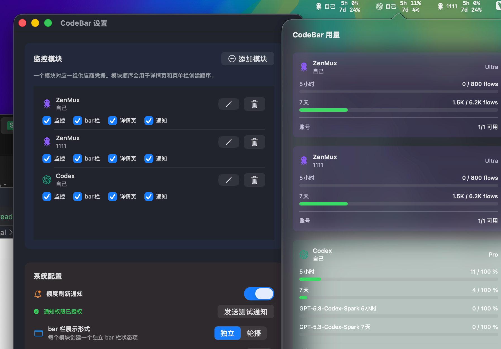
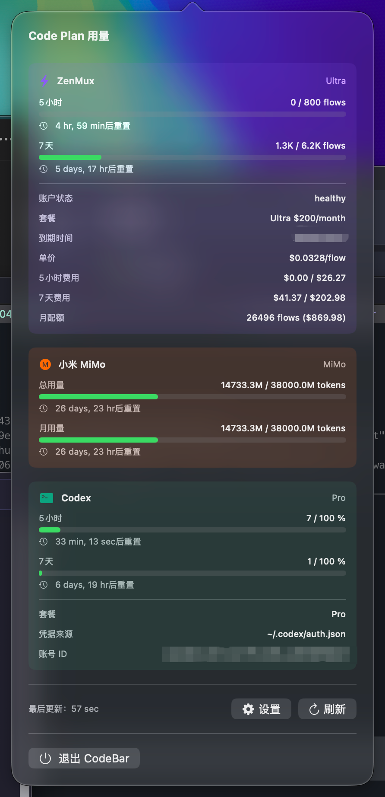
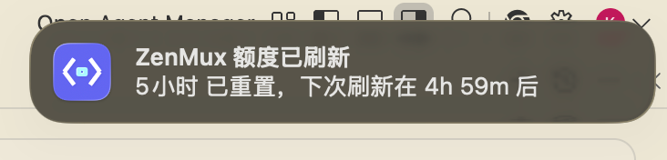

<div align="center">

# CodeBar

**macOS 菜单栏里的 AI Coding 用量雷达。**

[](#系统要求)
[](#开发)
[](https://github.com/wayyoungboy/code_bar/releases/tag/v2.2.8)
[](LICENSE)

一个实时监控 AI Coding 平台额度的 macOS 菜单栏应用。把 BaiLian、ZenMux、MiMo、Codex、Gemini、Grok、Antigravity 的用量和重置时间收进菜单栏，适合同时维护多个账号、多个团队额度的人。

</div>



> **必须用 Mac。** 这是 Xcode 工程（`CodeBar.xcodeproj`，scheme `CodeBar`），没有 `Package.swift`，不能用 Swift Package Manager 安装，也不能在 Linux / Windows 上构建或运行。本仓库的 GitHub Actions 只在 `macos-15` 上做 `xcodebuild` 编译与脚本测试，**不会启动 GUI**。

## Highlights

| 能力 | 说明 |
|---|---|
| 多平台监控 | 阿里云百炼、ZenMux、小米 MiMo、Codex、Gemini、Grok、Antigravity |
| 多账号模块 | ZenMux 支持多个账号模块，每个账号独立展示 |
| 菜单栏策略 | 支持独立状态项和轮播状态项两种展示方式 |
| 刘海 Island | 可切换刘海 Island 展示（见设置里的展示模式） |
| 配额提醒 | 5 小时、7 天、周、月等周期可按模块开启提醒 |
| 本地存储 | CodeBar 自身配置统一写入 `~/.code_bar/` |
| OAuth 免配置 | 自动读取本机 Codex CLI / Gemini CLI OAuth 凭据 |

## Preview

| 多模块监控 | Codex 用量 | 额度刷新通知 |
|---|---|---|
|  |  |  |

## 支持平台

- **阿里云百炼**：监控 Coding Plan 用量（账单月、5 小时、周）
- **ZenMux**：监控 Flow 用量（5 小时、7 天），支持按账号添加独立监控模块
- **小米 MiMo**：监控 Token 用量（月用量、总用量）
- **Codex**：自动读取 Codex CLI 的 ChatGPT OAuth 凭据，查询官方 5 小时 / 7 天订阅额度
- **Gemini**：自动读取 Gemini CLI 的 Google OAuth 凭据，查询官方 Code Assist 配额
- **Grok**：默认读取本地周额度快照，可选择后台调用官方 CLI 刷新
- **Antigravity / AGY**：支持桌面端与 agy CLI，展示 Gemini、Claude/GPT 等模型池额度

想支持更多平台？欢迎提交 PR。

## 功能特性

- 通过「添加模块」逐个添加供应商账号或凭据
- 每个模块可配置别名，方便区分个人、团队或项目账号
- 每个模块可独立选择是否监控、是否显示在菜单栏、是否显示在详情页
- 设置页支持拖动模块排序，详情页和菜单栏按模块顺序展示
- 菜单栏多模块展示支持「独立」和「轮播」两种模式
- 弹窗按模块独立展示用量、套餐、重置时间和额外信息
- 每个模块的配额周期可独立选择是否展示，以及是否展示剩余重置时间
- ZenMux 支持添加多个 Management API Key，每个账号都是一个独立模块
- ZenMux 展示账号用量和完整订阅信息（套餐、费用、单价、到期时间等）
- ZenMux 额度刷新通知（5 小时 / 7 天周期自动提醒）
- Codex 自动读取本机 Codex CLI OAuth，无需在 CodeBar 中配置 token
- Codex 支持可选代理请求 `chatgpt.com/backend-api/wham/usage`
- Gemini 自动读取本机 Gemini CLI OAuth，无需在 CodeBar 中配置 token
- Gemini 支持可选代理请求 Google Code Assist 配额接口
- Grok 默认读取本地额度缓存，后台 CLI 刷新需手动开启，并展示刷新状态与缓存同步时间
- Antigravity 自动发现本机桌面端，也可指定 agy CLI 路径查询额度
- Codex 请求在原生连接失败时自动使用兼容通道，保持证书校验并沿用模块或系统代理
- 自动刷新（每 60 秒，带随机 jitter 避免风控）

## 系统要求

| 项 | 实际值（来自工程文件） |
|---|---|
| 运行 / 部署目标 | **macOS 13.0+**（`MACOSX_DEPLOYMENT_TARGET`、`LSMinimumSystemVersion`） |
| 语言 | **Swift 5.0**（`SWIFT_VERSION = 5.0`） |
| 本地开发 | **Xcode 15.0+**（`CreatedOnToolsVersion = 15.0`），且必须安装完整 Xcode.app，不能只装 Command Line Tools |
| 工程形态 | `CodeBar.xcodeproj` / scheme **CodeBar** / product **CodeBar.app** |
| 当前版本 | **2.2.8**（`CodeBar/Info.plist` 的 `CFBundleShortVersionString` 与 `MARKETING_VERSION`） |
| 签名 | 工程是 Automatic signing；源码构建建议关签名（与 CI / `build.sh` 一致） |
| 启动形态 | `LSUIElement = true`：**没有 Dock 图标**，图标只出现在菜单栏 |

Linux、GitHub `ubuntu-*` runner、Windows 都无法编译这个 app。CI 用的是 `macos-15` + Xcode 16.x。

## 安装

### 从 Release 下载（需要 Mac）

1. 前往 [Releases](https://github.com/wayyoungboy/code_bar/releases) 下载最新 `CodeBar.dmg`（当前最新 tag 为 [v2.2.8](https://github.com/wayyoungboy/code_bar/releases/tag/v2.2.8)）
2. 双击打开 DMG，将 CodeBar 拖到 Applications
3. 首次打开时 macOS 可能提示“无法验证开发者”或“已损坏”，这是因为 DMG 未经 Apple 公证。解决方法：
   - 打开「系统设置 → 隐私与安全性」，拉到最下方，点击「仍要打开」
   - 或在终端执行：
   ```bash
   xattr -cr /Applications/CodeBar.app
   ```
4. 启动后看**菜单栏**，不要在 Dock 里找图标

### 从源码构建（需要 Mac + 完整 Xcode）

HTTPS 克隆（不要求配置 GitHub SSH key）：

```bash
git clone https://github.com/wayyoungboy/code_bar.git
cd code_bar
```

**推荐：用 Xcode GUI**

```bash
open CodeBar.xcodeproj
```

在 Xcode 里选 scheme `CodeBar`，destination 选 **My Mac**，然后 Run（⌘R）。第一次运行若弹出签名/开发者证书提示，选本地开发团队或改用下面的无签名命令行构建。

**命令行 Debug 构建并启动：**

```bash
xcodebuild -project CodeBar.xcodeproj \
  -scheme CodeBar \
  -configuration Debug \
  -destination 'generic/platform=macOS' \
  -derivedDataPath build \
  CODE_SIGN_IDENTITY="" \
  CODE_SIGNING_REQUIRED=NO \
  CODE_SIGNING_ALLOWED=NO \
  ENABLE_USER_SCRIPT_SANDBOXING=NO \
  COMPILER_INDEX_STORE_ENABLE=NO \
  build

open build/Build/Products/Debug/CodeBar.app
```

Debug 构建会顺带跑 `CodeBarTests/run_module_behavior_tests.sh`（这是工程里的 Run Script build phase，**不是** XCTest target，所以不要用 `xcodebuild test`）。脚本只在 `CONFIGURATION=Debug` 时执行。

产物路径：`build/Build/Products/Debug/CodeBar.app`。不要用不带 `-derivedDataPath` 的 `xcodebuild`，否则 .app 会落到 `~/Library/Developer/Xcode/DerivedData/`，很难找。

也可以打无签名 Release 包：

```bash
./build.sh
```

`build.sh` **必须在 Mac 的交互式终端里跑**：它会 `read` 询问是否打开构建目录、是否创建 DMG。非交互环境（CI、管道）会卡住。脚本内部同样关闭 code signing，产物在 `build/Build/Products/Release/CodeBar.app`。CI 发版不走这个脚本：推送 `v*` tag 会触发 `.github/workflows/release.yml`，在 `macos-15` 上 `xcodebuild`、adhoc `codesign`、打 `CodeBar.dmg` 并上传 Release。

## 使用方法

### 首次配置

1. 运行应用后，点击菜单栏的 CodeBar 图标（没有 Dock 图标是正常的）
2. 点击设置按钮（齿轮图标）
3. 点击「添加模块」，选择供应商并填写该模块需要的凭据
4. 保存后，可在模块列表中切换「监控」「bar栏」「详情页」
5. 拖动模块列表调整展示顺序
6. 进入模块编辑页，勾选需要展示的配额周期和重置时间

### 模块代理

每个供应商模块的编辑窗口都有「代理（可选）」字段，可分别设置，例如：

```text
http://127.0.0.1:7890
socks5://127.0.0.1:1080
```

- 百炼、ZenMux（每个账号独立）、MiMo、Codex、Gemini 的用量请求使用该模块的代理；Gemini OAuth 刷新也使用同一代理。
- Grok 开启后台 CLI 刷新后才将代理传给刷新进程；默认缓存模式不发起网络请求。
- AGY 配置代理后通过 `agy` CLI 查询，需已安装并登录 CLI；本机 Language Server 通信始终直连。留空时仍优先探测桌面端，其对外代理由 Antigravity 自身管理。
- 代理留空会沿用原有系统网络或 CLI 环境；修改一个模块不会影响其他模块。
- 地址必须包含协议、主机和端口；暂不支持带账号密码的代理 URL。无效地址会提示并禁用保存。

### 阿里云百炼

在设置界面点击「添加模块」，选择「阿里云百炼」，填入：

- **Cookie**：从浏览器复制的完整 Cookie 字符串
- **Sec Token**：从请求中复制的 `sec_token` 值
- **区域**：选择 `cn-beijing`、`cn-shanghai`、`cn-shenzhen` 或 `cn-hangzhou`

获取步骤：

1. 登录 https://bailian.console.aliyun.com/
2. 打开开发者工具，切到 Network
3. 进入 Coding Plan 页面
4. 找到 `api.json` 请求
5. 从请求头复制 Cookie 和 `sec_token`

### ZenMux

在设置界面点击「添加模块」，选择「ZenMux」。每个 ZenMux 账号对应一个独立模块，填入：

- **账号别名**：用于区分项目、团队或个人账号
- **Management API Key**：从 ZenMux 管理页面复制的 Management API Key

注意：仅支持 Management API Key，标准 API Key 无效。

每个账号模块可以独立勾选是否展示 5 小时 / 7 天配额，以及是否展示对应重置时间。详情页中每个 ZenMux 账号会作为独立模块展示，不再按平台聚合。

ZenMux 5 小时或 7 天额度周期刷新时，CodeBar 可发送 macOS 系统通知。同一周期内不会重复提醒，设置界面可开关通知并发送测试通知。

### 小米 MiMo

在设置界面点击「添加模块」，选择「小米 MiMo」，填入：

- **Service Token**：浏览器 Cookie 中的 `api-platform_serviceToken`
- **User ID**：浏览器 Cookie 中的 `userId`

获取步骤：

1. 访问 https://platform.xiaomimimo.com/ 并登录
2. 打开开发者工具，切到 Application
3. 在 Cookies 中找到 `platform.xiaomimimo.com`
4. 复制 `api-platform_serviceToken` 和 `userId`

### Codex

在设置界面点击「添加模块」，选择「Codex」。Codex 不需要在 CodeBar 中配置 token，CodeBar 会自动读取本机 Codex CLI 的 ChatGPT OAuth 文件凭据：`~/.codex/auth.json`。

要求：

- Codex CLI 已登录 ChatGPT
- `auth_mode` 为 `chatgpt`
- OAuth 凭据中存在 `tokens.access_token`

CodeBar 请求的官方接口：

```text
GET https://chatgpt.com/backend-api/wham/usage
```

请求头与 Codex CLI / cc-switch 对齐：

```text
Authorization: Bearer <access_token>
User-Agent: codex-cli
Accept: application/json
ChatGPT-Account-Id: <account_id>   # 如存在
```

支持展示：

- `plan_type`，例如 `Pro`
- 主 `rate_limit` 的 5 小时 / 7 天窗口
- `additional_rate_limits`
- `credits`
- `spend_control`
- `rate_limit_reset_credits.available_count`

如果直连 `chatgpt.com` 不稳定，可以在 Codex 模块中填写代理地址：

```text
http://127.0.0.1:7890
socks5://127.0.0.1:7890
```

未填写模块代理时，沿用 macOS 的系统网络配置，不会添加固定代理；系统也未设置代理时直接请求。

### Gemini

在设置界面点击「添加模块」，选择「Gemini」。Gemini 不需要在 CodeBar 中配置 token，CodeBar 会自动读取本机 Gemini CLI 的 Google OAuth 文件凭据：`~/.gemini/oauth_creds.json`。

要求：

- Gemini CLI 已使用 Google OAuth 登录
- OAuth 凭据中存在 `access_token`
- 如果 `access_token` 过期，凭据中需要有 `refresh_token` 用于刷新

CodeBar 请求的官方接口与 cc-switch 对齐：

```text
POST https://cloudcode-pa.googleapis.com/v1internal:loadCodeAssist
POST https://cloudcode-pa.googleapis.com/v1internal:retrieveUserQuota
```

支持展示：

- Gemini Pro
- Gemini Flash
- Gemini Flash Lite

如果直连 Google Code Assist 接口不稳定，可以在 Gemini 模块中填写代理地址：

```text
http://127.0.0.1:7890
socks5://127.0.0.1:7890
```

### Grok

在设置界面点击「添加模块」，选择「Grok」。默认读取 `~/.grok/`，可选指定其他 Grok 目录。

- 先安装并登录官方 Grok CLI，在 Grok 中运行 `/usage` 生成额度快照。
- CodeBar 默认只读取 CLI 写入的 `logs/unified.jsonl`，不在后台启动 CLI，也不读取或复制 Grok OAuth 凭据。
- 可在模块编辑窗口开启「后台调用 Grok CLI 刷新」。完整 CLI 会加载自身配置和插件，可能触发额外的系统文件权限请求；CodeBar 将其工作目录限制在 `~/.code_bar/cli-workspaces/grok/`。
- 展示套餐、周额度、重置时间和同步时间。后台刷新失败时继续展示最近缓存并标注刷新状态。

### Antigravity / AGY

在设置界面点击「添加模块」，选择「Antigravity」。

- 桌面版：启动并登录 Antigravity，CodeBar 自动发现本机 Language Server 的端口和 CSRF Token。
- CLI：安装并登录官方 `agy`。CodeBar 支持 `agy -p /usage --output-format json`；填写「agy CLI 路径」可优先使用指定 CLI。
- 默认展示 Gemini 的 5 小时和周额度；详情页展示接口实际返回的全部模型池额度，包括 Claude/GPT 和 Argon。
- 本地端点和 CSRF Token 为可选高级配置；仅支持本机 HTTP/HTTPS 地址。

## 项目结构

当前可运行的应用是 Swift 菜单栏 app。仓库里还有旧 Go/Wails 残留，**构建时不要用它们**。

```text
code_bar/
├── CodeBar.xcodeproj/             # 唯一构建入口（不是 SPM）
│   ├── project.pbxproj
│   └── xcshareddata/xcschemes/CodeBar.xcscheme
├── CodeBar/
│   ├── CodeBarApp.swift           # 应用入口、菜单栏和弹窗管理
│   ├── MenuBarView.swift          # 弹窗 UI
│   ├── IslandMode.swift           # 刘海 Island 展示
│   ├── IslandPanelController.swift
│   ├── SettingsWindow.swift       # 设置窗口
│   ├── UsageTracker.swift         # 用量追踪器
│   ├── Constants.swift
│   ├── CodeBarFileStore.swift     # ~/.code_bar 文件存储
│   ├── StatusBarIconRenderer.swift
│   ├── StatusBarUsagePresentation.swift
│   ├── UpdateChecker.swift
│   ├── Info.plist                 # 版本 2.2.8，LSUIElement
│   └── Providers/
│       ├── PlatformProvider.swift
│       ├── BailianProvider.swift
│       ├── ZenMuxProvider.swift
│       ├── MimoProvider.swift
│       ├── CodexProvider.swift
│       ├── GeminiProvider.swift
│       ├── GrokProvider.swift
│       └── AntigravityProvider.swift
├── CodeBarTests/                  # Debug 构建期脚本测试，不是 XCTest target
│   ├── ModuleBehaviorTests.swift
│   ├── TestNotifications.swift
│   ├── UsageProviderTests.swift
│   └── run_module_behavior_tests.sh
├── .github/workflows/
│   ├── ci.yml                     # macos-15 xcodebuild Debug + 行为测试
│   └── release.yml                # 推送 v* tag 后打 DMG
├── build.sh                       # Mac 交互式 Release 打包
├── create_dmg.sh
├── frontend/                      # 遗留：旧 Go/Wails 前端产物，当前 app 不用
├── internal/tray/                 # 遗留：旧 Go tray，当前 app 不用
└── docs/
```

## 开发

扩展 Provider 的步骤见 [docs/developer-guide.md](docs/developer-guide.md)。仓库没有 `Package.swift`，不要运行 `swift build` / `swift test`。

### 构建验证（Mac + Xcode）

```bash
xcodebuild -project CodeBar.xcodeproj \
  -scheme CodeBar \
  -configuration Debug \
  -destination 'generic/platform=macOS' \
  -derivedDataPath build \
  CODE_SIGN_IDENTITY="" \
  CODE_SIGNING_REQUIRED=NO \
  CODE_SIGNING_ALLOWED=NO \
  ENABLE_USER_SCRIPT_SANDBOXING=NO \
  COMPILER_INDEX_STORE_ENABLE=NO \
  build

xcodebuild -project CodeBar.xcodeproj \
  -scheme CodeBar \
  -configuration Release \
  -destination 'generic/platform=macOS' \
  -derivedDataPath build \
  CODE_SIGN_IDENTITY="" \
  CODE_SIGNING_REQUIRED=NO \
  CODE_SIGNING_ALLOWED=NO \
  ENABLE_USER_SCRIPT_SANDBOXING=NO \
  COMPILER_INDEX_STORE_ENABLE=NO \
  build
```

单独跑行为测试（同样需要 Mac 上的 `swiftc` / macOS SDK）：

```bash
CONFIGURATION=Debug CodeBarTests/run_module_behavior_tests.sh
```

CI 与此相同：`.github/workflows/ci.yml` 在 `macos-15` 上选 Xcode 16.x，关签名后 Debug `xcodebuild`，再跑同一脚本。它**不能**代替真机点开菜单栏。

### 发布

1. 同步更新 `CodeBar/Info.plist` 的 `CFBundleShortVersionString` 和 `project.pbxproj` 的 `MARKETING_VERSION`
2. 提交版本变更
3. 创建并推送 tag：

```bash
git tag -a v2.2.8 -m "CodeBar v2.2.8"
git push origin v2.2.8
```

GitHub Actions（`macos-15`）会自动构建、adhoc 签名、创建 DMG 并上传到 GitHub Release。发版 runner 也必须是 Mac；本地 `./build.sh` 只适合自己做安装包。

## 安全性

- CodeBar 自身配置存储在 `~/.code_bar/`
- Codex OAuth 凭据只从 Codex CLI 已存在的位置读取，不复制 token 到 CodeBar 配置
- Gemini OAuth 凭据只从 Gemini CLI 已存在的位置读取，不复制 token 到 CodeBar 配置
- Grok 默认只读本地额度快照；后台 CLI 刷新需手动开启，完整 CLI 的文件访问可能需要额外权限
- Antigravity 自动探测的 CSRF Token 仅用于访问本机服务
- Codex 兼容请求通过标准输入传递认证头，不将 token 写入命令行参数
- 不会上传或分享任何凭据信息
- 默认不写运行期请求、用量或凭据相关日志

## 商标与 Logo

项目中展示的平台 Logo 仅用于标识对应服务，相关商标和 Logo 归各自权利方所有。CodeBar 与阿里云、ZenMux、小米、OpenAI、Google 无官方从属、授权或背书关系。

- ZenMux Logo 来源：[zenmux.ai](https://zenmux.ai/)
- Xiaomi / Mi Logo 来源：[mi.com](https://www.mi.com/)
- OpenAI / ChatGPT Logo 来源：[chatgpt.com/codex](https://chatgpt.com/zh-Hans-CN/codex/)
- Gemini Logo 来源：[gstatic.com](https://www.gstatic.com/lamda/images/gemini_sparkle_aurora_33f86dc0c0257da337c63.svg)

如相关权利方希望调整或移除展示，请通过 Issue 联系。

## 许可证

MIT License - 详见 [LICENSE](LICENSE)

## 贡献

欢迎提交 Issue 和 Pull Request。请在 **Mac + Xcode 15+** 上按上面的 `xcodebuild` 命令验证 Debug 构建；不要新增 Linux CI。改 UI 后需要在真机菜单栏里点一遍，Actions 编译通过不等于 GUI 可用。

## 致谢

- [阿里云百炼](https://bailian.console.aliyun.com/) — Code Plan 用量监控
- [ZenMux](https://zenmux.ai) — AI Coding 平台
- [小米 MiMo](https://platform.xiaomimimo.com/) — AI 编程平台
- [OpenAI Codex](https://openai.com/codex/) — Codex CLI / ChatGPT OAuth 用量
